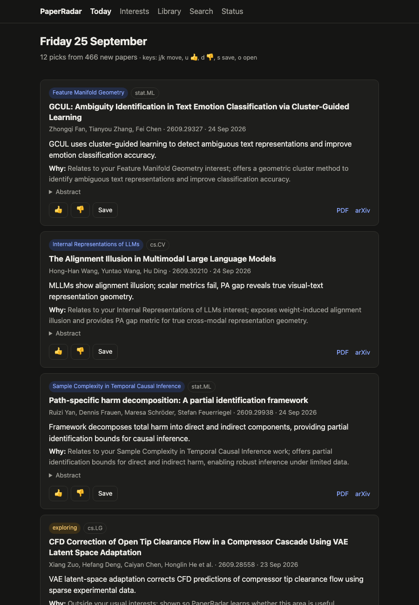
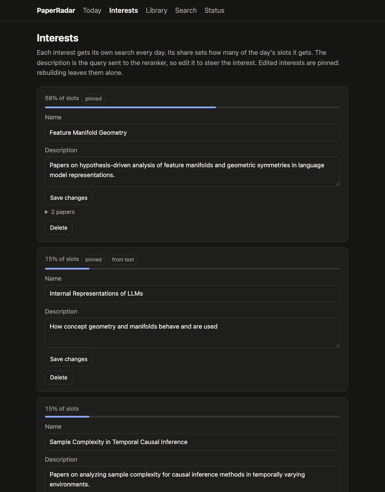
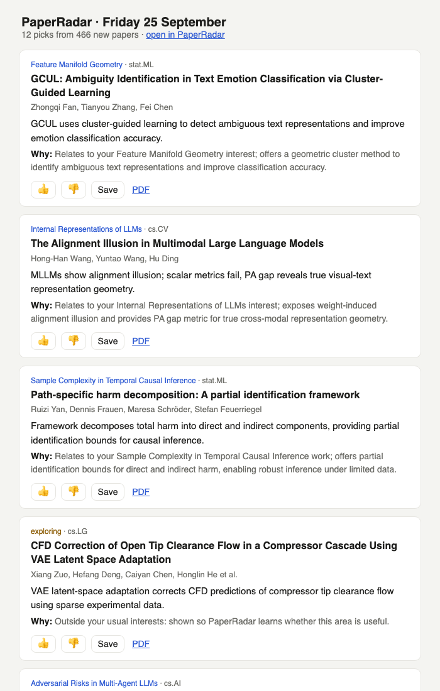
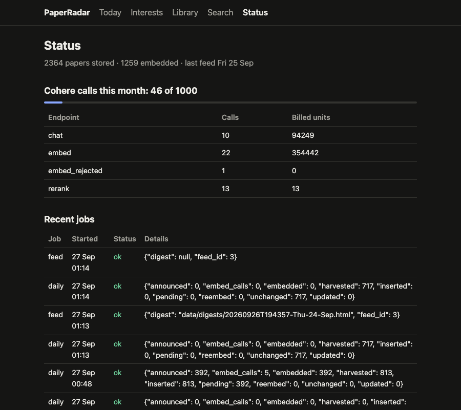
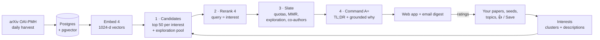

# PaperRadar

**A personal arXiv feed, built on Cohere.** Every morning PaperRadar reads the day's new machine-learning papers (roughly 400–470 per weekday), picks the 12 that matter to *you*, and explains each pick in one line. Rate papers with 👍 / 👎 and the feed adapts.



## Contents

- [Features](#features)
- [Quickstart](#quickstart)
- [Setting up your profile](#setting-up-your-profile)
- [Using PaperRadar](#using-paperradar)
- [How it works](#how-it-works)
- [Cohere usage and cost](#cohere-usage-and-cost)
- [Technical tradeoffs](#technical-tradeoffs)
- [Problems we hit and how we solved them](#problems-we-hit-and-how-we-solved-them)
- [Evaluation](#evaluation)
- [Configuration](#configuration)
- [Deploying on a server](#deploying-on-a-server)
- [Development](#development)
- [Limitations and roadmap](#limitations-and-roadmap)

---

## Features

- **Personal daily feed.** Papers from `cs.LG`, `cs.CL`, `cs.AI`, `cs.CV` and `stat.ML` (cross-lists included), ranked for your research interests.
- **Several interests, not one average.** Your papers are clustered into topics. Each topic gets its own search and a share of the feed, so an RL + interpretability researcher gets both, not a blur of the two.
- **"Why this paper?"** A one-line TL;DR, and a reason that names the interest or paper of yours it relates to. It says so when the link is loose.
- **Learns from you.** 👍 and Save add a paper to your profile, and 👎 is logged for the learned ranker (see the roadmap). Two exploration slots a day test adjacent topics, so the feed doesn't narrow into an echo chamber.
- **Editable interests.** Rename or rewrite an interest to steer it, delete one, or add one from a few seed papers or a sentence of text.
- **Email digest.** The same feed in your inbox, with 👍 / 👎 / Save links that work without logging in (they're signed, so they can't be forged).
- **Library and search.** Saved papers with one-click BibTeX export, and semantic search over every stored paper.
- **Co-author alerts.** New papers by your co-authors are always shown.
- **Runs itself.** A scheduler runs the daily job, catches up on missed days, and emails you if a run fails. A Status page shows jobs and API usage.
- **Stays inside the free tier.** Every Cohere call is counted, and a budget guard keeps you within the trial key's monthly limit.

| Interests | Email digest | Status |
|---|---|---|
|  |  |  |

---

## Quickstart

All you need is a **Cohere API key**. A free trial key is enough: [dashboard.cohere.com/api-keys](https://dashboard.cohere.com/api-keys).

### Option A: Docker (recommended)

Requires [Docker](https://docs.docker.com/get-docker/) with Compose.

```bash
git clone <this repo> paper-radar && cd paper-radar
make up          # asks for your Cohere key, writes .env, builds and starts everything
```

Open **http://localhost:8000** and set up your profile.

On first start the worker loads the last three days of arXiv papers. That takes about 5 minutes on a trial key; `make logs` shows progress. Stop with `make down`; your data is kept.

### Option B: Without Docker

Requires Python 3.12+, [uv](https://docs.astral.sh/uv/), and PostgreSQL 16+ with [pgvector](https://github.com/pgvector/pgvector).

```bash
# macOS: brew install postgresql@17 pgvector && brew services start postgresql@17
# Debian/Ubuntu: apt install postgresql postgresql-17-pgvector
make setup       # asks for your key, creates the database, loads the last 3 days of papers
make run         # starts the web app and the daily scheduler
```

Open **http://localhost:8000**.

---

## Setting up your profile

The setup page asks for your name and **any one** of the following. More sources give a better start.

| Source | What happens | Best for |
|---|---|---|
| **Semantic Scholar author ID** | Your arXiv papers become your profile and are clustered into interests. The ID is the number at the end of your `semanticscholar.org/author/<name>/<ID>` URL. | Anyone with papers |
| **Papers you like** (arXiv IDs or links) | They become one interest, named and described automatically. | Students; new directions |
| **A topic** as `Name: description` | An interest defined by text alone, e.g. `Efficient inference: speculative decoding and KV-cache compression`. | Topics you have no papers in yet |

After setup you land on your first feed. Open **Interests** to check them: rename, rewrite, delete, or add more.

From the command line instead:

```bash
uv run python -m radar.cli onboard --name "Ada Lovelace" --email ada@example.org \
    --s2 12345678 --seed 2301.05217 2209.11895 --text "Interpretability: circuits in transformers"
```

---

## Using PaperRadar

| Page | What it's for |
|---|---|
| **Today** | The day's picks. Keys: `j`/`k` move, `u` 👍, `d` 👎, `s` save, `o` open. Browse earlier days with ← →. |
| **Interests** | Your topics and their share of the feed. Edited interests are *pinned* and survive "Rebuild interests". |
| **Library** | Saved papers; **Export BibTeX**. |
| **Search** | Semantic search over every stored paper (one Cohere call per search). |
| **Status** | Recent jobs, errors, and this month's Cohere calls against the budget. |

**How ratings shape the feed.** A 👍 or Save adds the paper to your profile. Before the next feed it's attached to its nearest interest, which increases that interest's weight. A 👎 is recorded as a negative label for the learned ranker (roadmap). Exploration picks you 👍 show which adjacent areas are worth widening into.

**Email digest.** Set the `SMTP_*` variables (see [Configuration](#configuration)). Without SMTP, digests are written to `data/digests/` as HTML so you can preview them.

---

## How it works



This is a standard multi-stage recommender. Each stage does what the one before it cannot: cheap-and-broad retrieval, then an accurate-but-costly reranker on the few survivors, then a slate that turns a ranked list into a good page.

### 1. Ingestion: what counts as "today's papers"

Every run harvests one OAI-PMH datestamp for the five category sets, in the `arXivRaw` format. A datestamp contains both **new submissions** and **revisions of old papers**; on the days measured, about half were revisions. `arXivRaw` carries the full version history, so a paper counts as new when it has exactly one version, first submitted at most 7 days before the datestamp. Only new papers enter that day's feed.

Upserts are keyed by arXiv ID, so every job is safe to re-run: a second run for the same day writes nothing and makes no API calls.

### 2. Representation

Each paper is embedded once with **Cohere Embed 4** (`title \n abstract`, `input_type=search_document`, 1024 dimensions, unit-normalized) and stored in pgvector with an HNSW cosine index. If a revision changes a paper's title or abstract, its vector is deleted and recomputed.

### 3. Profiles as several interests

A single averaged profile vector fails anyone with more than one topic: the mean of "causal inference" and "LLM safety" is close to neither. So each profile is split into interests.

1. **Recency weights.** $w_i = e^{-a_i/\tau}$ with $\tau = 365$ days. Authored papers age from publication; liked, saved and seed papers age from when you added them.
2. **Clustering.** Weighted k-means for $k = 2..6$, choosing $k$ by cosine silhouette. A $k$ is only eligible if every cluster has at least 2 papers, so one outlier can't become an interest.
3. **Small profiles (fewer than 4 papers).** There's too little data for k-means, but unrelated papers must not be merged. Two papers share an interest only if their cosine similarity is at least **0.40**, the measured 99th percentile for random pairs of same-day papers (median 0.22, over 79,800 pairs).
4. **Medoid, not mean.** Each interest is represented by its most central *real* paper, $\arg\max_j \sum_i w_i\, s(e_i, e_j)$. An average of scattered papers can land in empty space; a medoid can't. This follows Pinterest's PinnerSage.
5. **Weights.** An interest's weight is its share of the total recency weight. Text-only interests get the median weight.
6. **Descriptions.** Command A+ names each cluster and writes a one-sentence description. The description is shown and editable, and it's the query sent to the reranker (together with the name).

### 4. Stage 1: candidates

For each interest, take the top 50 of the day's papers by cosine similarity to its vector. Add an **exploration pool**: 20 papers sampled from those whose best rank for any interest falls between 50 and 300. These are near misses the feed would otherwise never show. Papers by co-authors are added as candidates too.

### 5. Stage 2: Rerank 4

Cosine similarity between separately embedded texts is coarse. A cross-encoder reads query and document together and judges relevance far better, but costs more per item, so it only sees stage-1 output. That's one `rerank-v4.0-fast` call per interest, with the query `"{name}: {description}"`. Each paper keeps its best score and the interest it matched.

### 6. Stage 3: the slate

- **Quotas.** The 12 slots are shared out by interest weight: every interest with candidates gets at least one slot, and each extra slot goes to the interest furthest below its proportional share.
- **Diversity.** Each interest's slots are filled by maximal marginal relevance (MMR). This stops three near-identical papers taking every slot:
  $$\text{pick } \arg\max_p\; \lambda\,\text{score}(p) - (1-\lambda)\max_{q \in \text{chosen}} s(e_p, e_q), \quad \lambda = 0.7$$
- **Interleaving.** Interests alternate, heaviest first, because rerank scores from different queries aren't comparable.
- **Exploration and co-authors.** Two exploration picks go at about ⅓ and ⅔ down the list. Co-author papers go first, up to 3.

The learned ranker (LightGBM LambdaRank over these scores plus author, paper-type and feedback features) is designed but not built yet; see the roadmap.

### 7. Explanations with a guardrail

One Command A+ call per feed returns structured JSON (a JSON schema is enforced). Each paper is sent with the interest it matched and that interest's two most similar papers. The model must say what it related the paper to: one of those papers, or the interest itself. **If it names anything else, the explanation is discarded** and replaced with a plain "Similar to: …" line. Exploration picks get fixed text ("Outside your usual interests…") rather than an invented connection.

---

## Cohere usage and cost

| Step | Model | Calls per weekday |
|---|---|---|
| Embed new papers (96 per call) | `embed-v4.0` | ~5 |
| Rerank candidates | `rerank-v4.0-fast` | 1 per interest (≤ 6) |
| TL;DRs and explanations | `command-a-plus-05-2026` | 1 |
| Search (on demand) | `embed-v4.0` | 1 per search |

That's about **10 calls per weekday, ~250 per month**, inside the trial key's 1,000. Titles and abstracts average **~282 tokens per paper**, measured over 1,252 papers.

The budget guard counts every call, including rate-limited ones. Past 80% of the monthly budget it blocks non-essential calls (explanations, reranking, search), and the feed falls back to cosine ranking and plain text. On a production key, raise `MONTHLY_CALL_BUDGET` and `EMBED_CALLS_PER_MINUTE`.

---

## Technical tradeoffs

| Decision | Alternative | Why this way |
|---|---|---|
| **Daily batch pipeline** | Rank on each page load | arXiv updates once a day. Precomputing makes pages plain database reads, makes API usage predictable, and means a failed day can simply be re-run. |
| **Postgres + pgvector** for metadata, vectors and logs | A dedicated vector database | One service to run and back up. HNSW on ~10⁵–10⁶ vectors is well within pgvector's range. |
| **1024-dim Embed 4 vectors** | 256 / 512 / 1536 (Embed 4 supports all) | A middle setting: ~4 KB per paper. A fixed column size is also what lets pgvector build an HNSW index. |
| **Several interests with medoids** | One averaged profile vector | Averages fail broad researchers, and medoids can't drift into empty space. The cost is clustering complexity and choosing k. |
| **Measured 0.40 threshold for small profiles** | Always one cluster below 4 papers | "Always one cluster" merged two unrelated papers (cosine 0.13) into a meaningless interest. See the next section. |
| **Rerank 4 on 50 candidates per interest** | Rerank everything / cosine only | A cross-encoder is much sharper than cosine, but running it on everything would cost ~5× the calls. |
| **Interleave interests** | Sort by rerank score | Scores from different queries aren't on one scale. A text-described interest scored higher across the board and took the whole top of the feed. |
| **2 exploration slots** | Pure exploitation | Without exploration, feedback only confirms what's already shown and the feed narrows. The cost is 2 weaker slots a day, clearly labelled. |
| **One LLM call per feed, with a JSON schema and a guardrail** | One call per paper / free text | 12× fewer calls, and the guardrail makes a bad explanation degrade to plain text instead of misinforming. |
| **Command A+ with thinking on** | Command A (03-2025), or thinking off | Structured output on A+ fails with thinking off (422). On the trial key calls are the limit, not tokens, so the ~4× token cost doesn't matter; `CHAT_MODEL` switches it. |
| **Server-rendered HTML + HTMX** | React SPA | A product-grade UI with no JS build or second deploy. The tradeoff is less client-side interactivity. |
| **Single user, auth at the proxy** | Built-in accounts | Personal use. Caddy basic auth protects the app, and signed tokens let email links work without a login. The data model already has `user_id` everywhere. |
| **Untrained pipeline first** | Build the learned ranker first | The ranker needs a citation benchmark (~5,500 API calls, months of trial quota). Shipping without it starts collecting real ratings immediately. |

---

## Problems we hit and how we solved them

Each of these came up while building and running PaperRadar against the live APIs.

| Problem | Root cause | Fix |
|---|---|---|
| **The documented arXiv harvesting endpoint had moved** | arXiv replaced `export.arxiv.org/oai2` with `oaipmh.arxiv.org/oai`. | Verified the new endpoint and its per-category sets (`cs:cs:LG`, …) before building on them. |
| **Old papers showing up as "today's"** | A datestamp includes revisions and metadata edits of papers from years ago. | Switched to `arXivRaw` for version history; "new" means a single version submitted ≤ 7 days before. Checked on consecutive days: no paper was counted twice. |
| **Cohere 429s despite staying under the published limit** | Published trial limits disagree (2,000 inputs/min vs 5 calls/min). In practice the **4th call of 96 abstracts within a minute** was rejected, consistent with a ~100k tokens/min cap. The SDK's hidden retries also tripled every rejected request. | Throttle both calls and inputs per minute (3 calls/min by default), turn off SDK retries, and wait out the full minute on a 429. Later runs had no 429s. |
| **Quota under-counting** | Usage was written inside the job's transaction, so a failed job rolled back the record of calls it had already made. Rejected calls may also count against the cap. | The usage tracker commits in its own transaction and records rejected calls separately. |
| **arXiv's export API returning 406 for minutes at a time** | Intermittent on arXiv's side: the same URL succeeded from curl while failing from the app, and it recovered by itself. | Batches of 10 papers or fewer go straight to OAI-PMH `GetRecord`. Larger batches try the export API 3 times, then fall back to OAI-PMH. |
| **Command A+ replies failing to parse, then 422s** | A+ is a reasoning model: the reply starts with a `thinking` block, and disabling thinking makes JSON-schema output fail. | Take the `text` content item, and keep thinking on. |
| **Author names like `Pawe{\l} M\k{a}ka`** | arXiv metadata uses LaTeX accents. | Convert to Unicode at ingestion with `pylatexenc` (206 stored papers fixed). |
| **Stale vectors after a revision** | A new version can change the abstract while the old embedding stays. | Upserts detect title/abstract changes, delete the vector, and the daily job re-embeds it. |
| **One interest taking the whole top of the feed** | Sorting by rerank score across interests: each interest has its own query, so the scores aren't comparable. | Interleave interests by weight. |
| **Forced, first-person explanations** ("relevant to *our* study…", a legal-reasoning paper linked to interpretability) | Explanations were anchored only to the nearest profile papers, including for exploration picks. | Anchor to the matched interest and its papers, require the model to cite what it relates to (guardrail), forbid "our/we", and give exploration picks fixed text. |
| **A LiDAR odometry paper matched "Internal Representations of LLMs"** | For `Name: description` topics, the subject ("LLMs") was only in the name, and only the description was used as the query. | Queries and text-interest vectors now use `name: description`. |
| **Two unrelated papers merged into one interest** | Profiles under 4 papers were forced into one cluster. The two papers had cosine 0.13, below the *median* for random pairs. | The measured 0.40 same-topic threshold (99th percentile for random pairs). |
| **Onboarding hung for 5 minutes, then left an empty user** | The export API outage above, plus onboarding wasn't atomic. | The OAI fallback, and failed onboarding now deletes the half-created user and shows the error. |
| **Empty feeds on some days** | arXiv doesn't announce at weekends or on holidays. | Jobs treat empty days as normal. Bootstrap walks back to the last *announcement* days, and the scheduler catches up on missed days. |
| **Schema drift between ORM models and migrations** | Hand-written migrations. | Checked with Alembic autogenerate after every migration (zero differences). |

Measured values and the dates they were checked are in [docs/data_sources.md](docs/data_sources.md).

---

## Evaluation

**Current status.** The ranking pipeline is **not yet benchmarked**. Nothing in this README claims a measured accuracy gain. What *is* measured is operational: daily volumes, token costs, rate limits, and the similarity baselines above.

**Planned offline benchmark (future-citation replay).** Take thousands of researchers' papers up to a cut-off date $T$, rank the arXiv papers released just after $T$, and check whether the papers each researcher **later cited** rank near the top (Recall@20, NDCG@10, paired bootstrap confidence intervals). Results will be broken down by researcher type: junior vs. senior, specialist vs. interdisciplinary, field, and theory vs. empirical. That breakdown tests whether multi-interest profiles help broad researchers most, as designed. The ablation ladder runs from recency → BM25 → single vector → multi-interest → + Rerank 4 → + learned ranker.

**Online.** Every feed logs impressions, clicks, ratings and saves per slot type and model version. The plan includes team-draft interleaving to compare two rankers on a single user. Full design: [docs/PLAN.md](docs/PLAN.md).

---

## Configuration

Everything lives in `.env`. Only `COHERE_API_KEY` is required; see [.env.example](.env.example) for all options.

| Variable | Default | Purpose |
|---|---|---|
| `COHERE_API_KEY` | none | **Required.** |
| `ARXIV_CONTACT_EMAIL` | empty | Sent to arXiv so they can contact you about your harvester. |
| `SMTP_HOST`, `SMTP_USER`, `SMTP_PASSWORD`, `SMTP_FROM` | empty | Email digest. For Gmail, use `smtp.gmail.com` and an [app password](https://support.google.com/accounts/answer/185833). |
| `DAILY_HOUR`, `TIMEZONE` | `7`, `UTC` | When the daily job runs. |
| `APP_BASE_URL` | `http://localhost:8000` | Base for links in emails. |
| `CHAT_MODEL`, `RERANK_MODEL` | `command-a-plus-05-2026`, `rerank-v4.0-fast` | `command-a-03-2025` uses ~4× fewer tokens; `rerank-v4.0-pro` is more accurate. |
| `MONTHLY_CALL_BUDGET`, `EMBED_CALLS_PER_MINUTE` | `1000`, `3` | Trial-key limits; raise them on a production key. |
| `SEMANTIC_SCHOLAR_API_KEY` | empty | Optional; avoids Semantic Scholar rate limits during onboarding. |

Feed shape is set in `radar/config.py`: `feed_size`, `explore_slots`, `candidates_per_interest`, `mmr_lambda`, `max_interests`, `recency_tau_days`.

---

## Deploying on a server

On any small VPS (2 vCPU / 4 GB) with Docker and a domain pointing at it:

```bash
make up                           # once, to create .env
# In .env set DOMAIN, BASIC_AUTH_USER, BASIC_AUTH_HASH, SMTP_*
#   hash: docker run --rm caddy:2 caddy hash-password
make deploy
```

This adds **Caddy** (automatic HTTPS, with basic auth on everything except the signed email links) and a **nightly `pg_dump`** kept for 14 days in `./backups`. Copy those off the server, for example with rclone to object storage.

---

## Development

```bash
createdb paperradar_test      # database tests skip themselves without it
make test                     # 42 tests; Cohere is replaced by fakes
make lint
```

**Useful commands:**

```bash
uv run python -m radar.jobs.daily --date 2026-09-25 --no-email   # one day, end to end
uv run python -m radar.cli feed --date 2026-09-25 --rebuild        # rebuild a feed and print it
uv run python -m radar.cli interests                               # list interests and weights
uv run python -m radar.cli rebuild-interests                       # recluster unpinned interests
uv run python -m radar.ingest.kaggle_backfill --file arxiv.json --from 2024-01-01 --to 2024-03-31
```

**Layout:**

```text
radar/
  ingest/    OAI-PMH harvester, by-ID fetch with fallback, Kaggle backfill, upsert
  embed/     Embed 4 client and the embed-missing step
  profile/   clustering into interests; interest maintenance
  rank/      candidates, slate, feed builder
  explain/   TL;DRs and grounded explanations
  app/       FastAPI + Jinja + HTMX web app
  email/     digest and failure alerts
  jobs/      daily job, scheduler, job-run log
  db/        SQLAlchemy models and Alembic migrations
  cohere_calls.py  llm.py  usage.py  feedback.py  config.py  cli.py
tests/       parser, ranking, database and end-to-end tests
docs/        design plan, measured data-source notes, screenshots
```

---

## Limitations and roadmap

**Limitations**
- **No learned ranker yet.** The score is Rerank 4 relevance, so 👎 doesn't change ranking yet (it's logged for the ranker).
- **Single user per install.** The schema supports several users, but the app shows the first one.
- **Titles and abstracts only.** No full text.
- **ML categories by default.** Others can be added via `OAI_SETS`.
- **Word-level false positives remain,** e.g. a "geometry" interest matching pronunciation geometry. 👎 ratings are the intended fix.

**Roadmap**
1. Future-citation benchmark and ablations (needs a production key: roughly $15–25 of Cohere usage).
2. LightGBM LambdaRank trained on the benchmark, plus a per-user layer trained on 👍/👎.
3. A paper-type tagger (theory / method / benchmark / survey) distilled from Command A+ into a local classifier.
4. Team-draft interleaving for online comparison of rankers.
5. Zotero sync, "more like this", and more sources (OpenReview, ACL Anthology).
