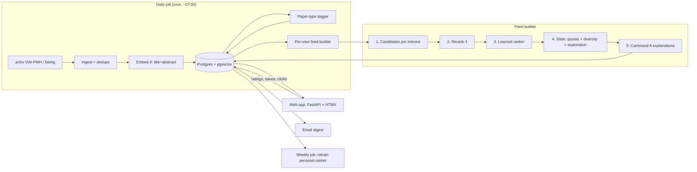

# PaperRadar: Build Plan

> [!NOTE]
> **What this is.** The build plan for PaperRadar, a personal arXiv recommender that I deploy and use every day. It has to work as a product *and* have a real ML component I can show on a resume.
>
> **Who it is for.** Me while building it, and me six months from now. The document therefore records the *reason* behind each design choice, not only the choice.
>
> **Assumed background.** Python, basic ML (embeddings, classifiers, train/test splits), basic web backends.
>
> **Deliberately skipped.** Multi-tenant SaaS concerns (billing, sign-up, scale), full-text PDF parsing, and non-arXiv sources. These are listed under Non-goals with the reasons.
>
> **Numbers.** No result in this document is measured yet. Every target is marked **target**, and every metric slot in a results table is `[TBD]` until it has a run id behind it.

## Contents

1. [The product in plain words](#1-the-product-in-plain-words)
2. [Goals, non-goals, success criteria](#2-goals-non-goals-success-criteria)
3. [System overview](#3-system-overview)
4. [Data sources](#4-data-sources)
5. [The ranking pipeline](#5-the-ranking-pipeline)
6. [Offline evaluation: the future-citation benchmark](#6-offline-evaluation-the-future-citation-benchmark)
7. [Online evaluation on my own usage](#7-online-evaluation-on-my-own-usage)
8. [Product features](#8-product-features)
9. [Tech stack, data model, repo layout](#9-tech-stack-data-model-repo-layout)
10. [Deployment and operations](#10-deployment-and-operations)
11. [API quotas and cost](#11-api-quotas-and-cost)
12. [Milestones](#12-milestones)
13. [Risks and mitigations](#13-risks-and-mitigations)
14. [Resume framing](#14-resume-framing)
15. [Open decisions](#15-open-decisions)

---

## 1. The product in plain words

Every weekday, arXiv publishes a large batch of new papers in the ML-adjacent categories (measure the actual daily volume in week 1). Nobody can read every title. Existing options each fall short:

- **arXiv category listings** are chronological, not personal.
- **Twitter/X and Hugging Face daily papers** favour popular papers over relevant ones.
- **Generic "similar papers" tools** usually model a researcher as one topic. A person who works on both RL and interpretability gets an average of the two, which matches neither interest well.

**PaperRadar** gives me a short daily feed (about 10–15 papers) chosen from that day's arXiv submissions. It is ranked for *my* interests, and each paper comes with one sentence explaining why it was picked, tied to papers I have written or saved. I rate papers with 👍 / 👎 / save, and the ranking learns from those ratings.

**A day of use.**
1. 07:00: a scheduled job ingests yesterday's arXiv papers, embeds them, and builds my feed.
2. 08:00: an email digest arrives. I also open the web app on my phone.
3. I skim 12 papers, save 2, give 👍 to 1 and 👎 to 3 that missed. That takes about 5 minutes.
4. Once a week I open the **Interests** page. It shows the topic clusters the system thinks I care about; I rename one, delete one, and add a new one by pasting three seed papers.

**What makes it hard (and therefore worth building).**
- A researcher has **several interests**, and they drift over time.
- **Relevance is sparse.** On a given day, maybe 1–2% of papers matter to me.
- **Cold start.** A new interest, or a student with no papers, has no history to learn from.
- **Different researchers want different things** (§6.4): specialists want precision, interdisciplinary people want coverage, and theorists and empiricists want different *types* of paper.

---

## 2. Goals, non-goals, success criteria

### Goals
| # | Goal | Why |
|---|---|---|
| G1 | A deployed app I actually use daily | The product is the proof. A recommender I stopped using is a negative result about itself. |
| G2 | A multi-stage ranking pipeline (retrieve → rerank → learned ranker) | This is the standard industry recommender architecture and the core ML content. |
| G3 | An offline benchmark with results broken down **by researcher type** | Makes the ML claims measurable and reproducible, without needing other users. |
| G4 | A clean, reproducible repo with a write-up | Interviewers read the README before they read the code. |

### Non-goals (v1)
| Non-goal | Reason |
|---|---|
| Multi-tenant SaaS (sign-up, billing) | It is for personal use. The data model still keeps a `user_id` so a few friends can be added later. |
| Full-text PDF parsing | The title and abstract carry most of the relevance signal at far lower cost. Revisit only if the benchmark shows abstracts are the bottleneck. |
| Non-arXiv sources (ACL Anthology, OpenReview, bioRxiv) | Keep ingestion simple. The pipeline is source-agnostic, so adding them later is a small job. |
| A native mobile app | A responsive web app plus email covers phone use. |

### Success criteria
| Kind | Criterion | Status |
|---|---|---|
| Product | I open it on ≥ 4 of 5 weekdays for 4 consecutive weeks | **target** |
| Product | Share of top-10 papers I rate 👍 or save (precision@10 from my ratings) is higher than the embedding-only baseline over the same period (§7) | **target** |
| ML | Every ablation row in §6.6 filled in, with 95% bootstrap confidence intervals | **target** |
| ML | Results broken down by researcher segment (§6.4) | **target** |
| Eng | The daily job runs unattended for 2 weeks and alerts me on failure | **target** |

---

## 3. System overview

Two jobs and one web app share one Postgres database.



**Why a batch pipeline, not per-request ranking.** arXiv updates once a day, so the whole feed can be computed ahead of time. Page loads become plain database reads, the Cohere API is called a fixed number of times per day (important under the trial quota, §11), and a failed job can simply be re-run.

---

## 4. Data sources

| Source | Used for | Access notes |
|---|---|---|
| **arXiv OAI-PMH** (`export.arxiv.org/oai2`) | Daily ingestion of new papers and their metadata | Official bulk-harvest interface. Respect the published rate limit (one request every few seconds). Check the current arXiv API terms before building. |
| **arXiv RSS** (`rss.arxiv.org/rss/<cat>`) | Cheap cross-check that nothing was missed | Contains only new announcements. |
| **Kaggle arXiv metadata snapshot** (Cornell-University/arxiv) | Backfill of historical papers for the benchmark (§6) and search | A single JSON-lines file, updated periodically. Avoids hammering the API. |
| **Semantic Scholar Graph API** | My author profile; references and citations for the benchmark | A free API key raises the rate limit. `externalIds.ArXiv` links S2 papers to arXiv IDs. The bulk datasets are an option if the API is too slow. |
| **OpenAlex** | Fallback for references and author disambiguation | Free. Check the current auth and polite-pool rules. Matching arXiv IDs is messier than in S2. |
| **Hugging Face daily papers** | Optional popularity feature | Treat it as a weak feature only. Popularity is not relevance. |

> [!WARNING]
> Rate limits and terms for all of these change. Re-check each one during week 1 and record the checked values in `docs/data_sources.md` with the date.

**Categories for v1:** `cs.LG, cs.CL, cs.AI, cs.CV, stat.ML`, plus any categories I add in settings. Cross-lists count, so a paper cross-listed into cs.LG is ingested.

---

## 5. The ranking pipeline

This is the ML core. Each stage exists because the one before it cannot do the next job alone:
- Stage 1 is **cheap and broad** (vector search over everything).
- Stage 2 is **accurate but costly per item** (a cross-encoder reranker).
- Stage 3 **combines many signals** that neither model sees (authors, paper type, my feedback).
- Stage 4 turns a ranked list into a **good page**: several interests covered, no near-duplicates, some exploration.

### Notation
| Symbol | Type | Meaning |
|---|---|---|
| $p$ | paper | A candidate paper (title + abstract) |
| $e_p$ | $\mathbb{R}^d$, unit-norm | Embed 4 embedding of $p$ ($d$ = 1024 by default) |
| $u$ | user | A researcher (in v1, me) |
| $P_u$ | set of papers | Papers in $u$'s profile: authored, seed, or 👍'd/saved |
| $a_i$ | days | Age of profile paper $i$ at feed time |
| $w_i$ | $\mathbb{R}_{\ge 0}$ | Recency weight of profile paper $i$ |
| $I_u = \{c_1,\dots,c_k\}$ | set | $u$'s interests (clusters of $P_u$) |
| $\mu_c$ | $\mathbb{R}^d$ | Representative vector (medoid) of interest $c$ |
| $\pi_c$ | $[0,1]$ | Weight of interest $c$; the weights sum to 1 |
| $s(\cdot,\cdot)$ | $[-1,1]$ | Cosine similarity |

### 5.1 Paper representation

**Context.** Every later stage needs a fixed vector per paper, so embeddings are computed once per paper at ingestion and stored.

**Formal.** $e_p = \text{Embed4}(\text{title} \,\|\, \text{"\n"} \,\|\, \text{abstract})$ with `input_type="search_document"` and `output_dimension=1024`. Interest descriptions (§5.2) use `input_type="search_query"`. Store as `vector(1024)` in pgvector with an HNSW index on cosine distance.

**Rationale.**
- Embed 4 accepts shorter output dimensions. 1024 is a middle setting; the benchmark includes a {256, 512, 1024, 1536} ablation so this default is backed by a measurement.
- Storage is small: ~4 KB per paper as float32, and `halfvec` halves it if needed.
- An **open-source embedder** (e.g. BGE-M3) is run on the same benchmark as a baseline. This answers "is the paid API worth it?" and gives a fallback if the quota runs out.

### 5.2 User profile as several interests

**Context.** The single-vector profile (average all my papers) is the baseline to beat. It fails for anyone with more than one interest, because the average of "RL" and "interpretability" is close to neither.

**Intuition.** Group my papers into a few topic clusters and treat each cluster as a separate interest with its own search. Weight recent papers more, since interests drift. Represent each cluster by a *real paper* at its centre (a medoid) rather than an average. An average of scattered papers can land in an empty region of embedding space; a medoid is always a real paper. This follows Pinterest's PinnerSage design.

**Formal.**
1. Recency weight: $w_i = \exp(-a_i / \tau)$ with $\tau$ = 365 days (tune on the benchmark dev split).
2. Cluster $\{e_i : i \in P_u\}$ with weighted k-means for $k \in \{1,\dots,6\}$. Choose $k$ by silhouette score, with $k=1$ forced when $|P_u| < 4$. HDBSCAN is an ablation.
3. Medoid: $\mu_c = e_{j^*}$ where $j^* = \arg\max_{j \in c} \sum_{i \in c} w_i\, s(e_i, e_j)$.
4. Interest weight: $\pi_c \propto \sum_{i \in c} w_i$.
5. **Interest description.** Command A reads the titles and abstracts in cluster $c$ and writes a 1–2 sentence description ("Mechanistic interpretability of attention circuits in small transformers"). The description is **shown and editable** in the UI, and it is the query sent to Rerank 4 (§5.4).

**Consequence.** Interests become visible and editable objects. That is a product feature (I can fix a wrong cluster) and an ML feature (the benchmark can test single-vector vs. multi-interest profiles, which is exactly the specialist vs. interdisciplinary comparison in §6.4).

**Feedback updates.**
- 👍 or save → add the paper to $P_u$ with weight 1 and recluster nightly.
- 👎 → never enters $P_u$. It is a negative label for the personal ranker (§5.6).

### 5.3 Stage 1: candidate generation

**Context.** Take the day's papers (all ingested papers from today's announcement) and cut them to a few hundred plausible ones cheaply.

**Formal.** For each interest $c$, take the top $M$ = 50 papers by $s(e_p, \mu_c)$. Take the union over interests and add:
- **Exploration pool:** $E$ = 20 papers sampled uniformly from the similarity band ranked 50–300 for any interest. These are near misses the system would otherwise never show.
- **Rule-based items:** papers by authors I follow, and papers by my co-authors. Both are cheap, high-precision signals.

**Rationale.** The exploration pool exists because a recommender that only exploits never learns about adjacent interests, and its feedback data becomes self-confirming. It is small and clearly labelled in the UI ("exploring").

### 5.4 Stage 2: Rerank 4

**Context.** Cosine similarity between separately embedded vectors (a bi-encoder) is coarse. A cross-encoder reads the query and the document *together* and judges relevance much more precisely, but it is too expensive to run on everything. That is why it runs on stage-1 output only.

**Formal.** For each interest $c$: `rerank(model="rerank-v4.0-fast", query=description_c, documents=[title+abstract for candidates of c], top_n=30)`. The result is a score $r_c(p) \in [0,1]$. For each paper, keep $r(p) = \max_c r_c(p)$ and $c^*(p) = \arg\max_c r_c(p)$, the interest it matched.

**Rationale.**
- One call per interest per day, so at most ~6 calls per day.
- Start with `fast`. `rerank-v4.0-pro` is an ablation, to see whether the quality gain justifies the cost.
- Using an **editable text description** as the query, instead of a paper, lets me steer an interest in words.

### 5.5 Paper-type tagger (a small distillation)

**Context.** Theorists and empiricists want different *kinds* of papers, and topic similarity cannot tell them apart. The type needs to be a feature. Asking Command A to label every paper every day would use up the quota, so its knowledge is distilled into a free local classifier once.

**Labels (multi-label).** `theory`, `new-method (empirical)`, `benchmark/dataset`, `survey/tutorial`, `analysis/empirical study`, `systems/efficiency`, `application`, `position`.

**Procedure.**
1. Sample 3,000 historical abstracts, stratified by category.
2. Label them with Command A using a strict JSON schema (structured output), batching ~20 abstracts per call → ~150 calls in total.
3. Hand-label 200 of them myself. Report Command A's agreement with me (Cohen's κ per label) so the teacher's quality is **measured**, not assumed.
4. Train one-vs-rest logistic regression on the stored embeddings $e_p$ (cost ≈ 0, instant inference). Report per-label F1 against my 200 labels.

**Consequence.** Every paper gets a type vector at ingestion for free. This is also a small, complete distillation story for the write-up.

### 5.6 Stage 3: learned ranker

**Context.** No single score captures everything I care about. The ranker learns how to combine them.

**Model.** LightGBM with the `lambdarank` objective. It is a *learning-to-rank* model: it learns to order items within a group (one user's candidates for one day) rather than to predict absolute labels.

**Features (all computable at feed time with no future information).**
| Feature | Source |
|---|---|
| $\max_c s(e_p,\mu_c)$, similarity to the matched interest, and $\pi_{c^*}$ | §5.2–5.3 |
| Rerank score $r(p)$ | §5.4 |
| Similarity to the nearest single profile paper (not just the medoid) | embeddings |
| Author overlap with my co-authors; followed-author flag | metadata |
| Paper-type vector × my type preference vector (dot product) | §5.5 |
| Number of categories; primary-category match | metadata |
| Abstract length; code-link present (GitHub URL in abstract/comments) | metadata |
| HF daily-papers upvotes (if present at feed time) | optional |
| Exploration-pool flag | §5.3 |

**Training in two layers.**
1. **Global ranker** trained on the benchmark (§6). Groups are authors, labels are future citations. This works before I have given any ratings.
2. **Personal layer.** After ≥ 50 ratings, fit an L2-regularized logistic regression on [global score, top features] using my 👍/save (positive) vs. 👎 (negative). Blend: $\text{score} = (1-\beta)\,\text{global} + \beta\,\text{personal}$, where $\beta$ grows with the number of ratings. Retrain weekly.

**Rationale.** A global model trained on thousands of other researchers solves cold start. The personal layer then corrects it toward my taste. The two-layer split also keeps the personal model small enough to train on a few hundred ratings without overfitting.

### 5.7 Stage 4: building the slate

**Context.** The top 12 by score might all come from my largest interest, or be three near-identical LLM-agent papers.

**Rules, in order.**
1. **Interest quotas:** slot count per interest is proportional to $\pi_c$, with at least 1 per interest.
2. **Diversity:** fill each quota with MMR (maximal marginal relevance). Each pick maximizes $\lambda\cdot\text{score} - (1-\lambda)\max_{q\in\text{picked}} s(e_p,e_q)$, with $\lambda$ = 0.7.
3. **Exploration:** 2 of the ~12 slots come from the exploration pool (§5.3), marked in the UI.

### 5.8 Explanations and TL;DRs

For the final slate, make **one** Command A call. It receives the slate papers plus, for each one, the 2 most similar papers from my profile, passed as grounding `documents`. It returns JSON with a one-line TL;DR and a one-sentence "why this is relevant to you" that cites one of my papers. Command A's built-in citation feature keeps the explanation tied to real papers.

**Guardrail.** If an explanation cites a paper that is not in the grounding documents, drop the explanation and show similarity-based text instead ("Similar to: <my paper>").

---

## 6. Offline evaluation: the future-citation benchmark

**Context.** I cannot run an A/B test with thousands of users. I do have a lot of public evidence about what researchers find relevant: **the papers they later cite.** The benchmark replays history. Take a researcher's profile as of a date $T$, rank the papers released right after $T$, and check whether the ones they went on to cite rank near the top.

### 6.1 Construction

1. **Cut-off and window.** Choose a cut-off $T$ (e.g. 2024-01-01) and a candidate window $W = [T, T+90\text{d}]$. The **candidate pool** is every arXiv paper in the v1 categories announced in $W$.
2. **Authors.** Sample ~2,000 Semantic Scholar authors with:
   - ≥ 1 arXiv paper in the v1 categories before $T$ (≥ 3 for the main split, 0–2 for the cold-start split), and
   - ≥ 1 paper published in $[T, T+12\text{ months}]$ whose references include a pool paper.
3. **Profile** $P_u$ = the author's papers before $T$, with titles and abstracts only.
4. **Relevant set** $R_u$ = pool papers cited by the author's papers published in $[T, T+12\text{ months}]$, **excluding** papers the author co-wrote.
5. **Splits by author:** 60/20/20 train/dev/test. The ranker never sees test authors.

### 6.2 Leakage rules (the part most likely to go wrong)
- Features must use only data available at $T$ plus the paper's own metadata. **No citation counts, no future HF upvotes.**
- Co-authorship features use co-authors from *before* $T$ only.
- The author's own post-$T$ papers are never candidates.
- Report results **with and without** co-author features. Co-author signal is legitimate in the product, but it can inflate benchmark numbers.

### 6.3 Metrics
- **Primary:** Recall@20 and NDCG@10 per author, averaged over authors.
- **Secondary:** MRR; **interest coverage**, the share of an author's clusters that have ≥ 1 relevant paper in the top 20.
- **Daily-slice variant:** rank each day's papers separately (as the product does), and average over days that have ≥ 1 relevant paper. This matches the real product better but is noisier; report both.
- **Uncertainty:** 95% bootstrap confidence intervals over authors (1,000 resamples). Compare models with a **paired** bootstrap on the same authors.

### 6.4 Researcher segments ("each kind of researcher")
| Segment axis | Buckets | Hypothesis tested |
|---|---|---|
| Seniority | papers before $T$: 1–2 / 3–10 / 11–50 / 50+ | Does the global ranker carry juniors, and do seniors gain most from the personal features? |
| Breadth | tertiles of mean pairwise cosine distance within $P_u$ | Multi-interest profiles help broad researchers most. |
| Field | primary category (cs.CL, cs.CV, cs.LG, …) | Is any field systematically underserved? |
| Style | share of $P_u$ tagged `theory` by §5.5 | Does the paper-type feature matter mainly for theorists? |

> [!NOTE]
> These hypotheses are **conjectures**. The benchmark exists to test them. A "no difference" result is still reported, because it says the extra machinery is unnecessary for that segment.

### 6.5 Cold-start simulation
For authors in the cold-start split, start from $k \in \{1, 3, 5, 10, 20\}$ **seed papers**, drawn from papers they cited *before* $T$. These act like a student pasting a few papers they like. Plot NDCG@10 against $k$. The resulting curve gives the "how many ratings until it's useful" number for the README.

### 6.6 Ablation table (to be filled)

| Row | System | Recall@20 | NDCG@10 | Run id |
|---|---|---|---|---|
| A0 | Recency only (newest first) | [TBD] | [TBD] | |
| A1 | BM25 on title+abstract vs. profile titles | [TBD] | [TBD] | |
| A2 | Open-source embedder, single-vector profile | [TBD] | [TBD] | |
| A3 | Embed 4, single-vector profile | [TBD] | [TBD] | |
| A4 | Embed 4, multi-interest profile | [TBD] | [TBD] | |
| A5 | A4 + Rerank 4 (fast) | [TBD] | [TBD] | |
| A6 | A4 + Rerank 4 (pro) | [TBD] | [TBD] | |
| A7 | A5 + LightGBM ranker (no co-author features) | [TBD] | [TBD] | |
| A8 | A7 + co-author features | [TBD] | [TBD] | |
| A9 | A7 + paper-type features | [TBD] | [TBD] | |

Secondary sweeps: embedding dimension {256, 512, 1024, 1536}; recency $\tau$; clustering method (k-means vs. HDBSCAN); MMR $\lambda$ (measured by interest coverage).

**Every row is also reported for each segment in §6.4.** The segment table is the main result, not the overall averages.

### 6.7 Threats to validity (state these in the write-up)
- Citation is a strict proxy. People read and use far more papers than they cite, so absolute recall understates real usefulness. Comparisons *between systems* are still meaningful.
- Authors who cite arXiv papers heavily are over-represented.
- Semantic Scholar author disambiguation errors add noise to profiles.

---

## 7. Online evaluation on my own usage

A benchmark built on other researchers only approximates what I want. Logging my own usage is cheap, so every feed is logged.

- **Log:** impressions (paper, rank, slot type, model version), clicks (abstract / PDF), 👍 / 👎 / save, time on the page.
- **Weekly metrics:** precision@10 from my ratings, save rate, share of exploration slots that got 👍, and which interests the 👍s came from.
- **Comparing two rankers on one user: team-draft interleaving.** Each day, merge the rankings of model A and model B into one feed by alternating picks, and record which model's picks I click. With one user, this is far more sample-efficient than switching the whole feed between models on alternate days. Implement it after 2 weeks of baseline use.

---

## 8. Product features

### MVP (weeks 1–5)
| Page / surface | Contents |
|---|---|
| **Today** | 10–15 cards: title, authors, TL;DR, "why for you" line, interest tag, type tags, links (abs / PDF / code). 👍 👎 save buttons. Keyboard shortcuts (`j`/`k` to move, `s` to save). |
| **Interests** | The clusters, each with a name, description, weight, and member papers. Rename, edit the description, merge, delete, "add interest from seed papers". |
| **Library** | Saved papers, with BibTeX export. |
| **Search** | Semantic search over every ingested paper (Embed 4 query → pgvector → optional rerank). |
| **Onboarding** | Paste a Semantic Scholar author ID *or* 3–10 seed arXiv IDs *or* a free-text description. |
| **Email digest** | Daily at 08:00 with the same cards. 👍/👎 links in the email record the rating. |
| **Status** | Last job run, papers ingested, API calls used this month, errors. |

### v2 (after the core loop is stable)
- Zotero sync (read a collection as profile papers; push saved papers).
- "More like this" on any card: a temporary interest built from one paper.
- Weekly "what I missed" view: papers from the past week that became popular and matched an interest but were ranked low. This doubles as error analysis.
- Other sources (OpenReview, ACL Anthology).
- Telegram or Slack bot delivery.

---

## 9. Tech stack, data model, repo layout

### Stack
| Layer | Choice | Why |
|---|---|---|
| Language / env | Python 3.12, `uv` | Fast, reproducible installs |
| API | FastAPI | Typed and async; the same code serves the app and the rating links in emails |
| Frontend | Jinja2 templates + HTMX + Tailwind (CDN) | A product-like UI without a separate JS build or deploy. Streamlit is the fallback if frontend work stalls. |
| DB | Postgres 16 + pgvector (HNSW) | One store for metadata, vectors and logs. Plenty for ~1M papers. |
| Jobs | APScheduler in a worker container (or host cron calling `python -m radar.jobs.daily`) | Simple. Jobs can be re-run safely because upserts are keyed by arXiv ID. |
| ML | scikit-learn, LightGBM, numpy | These models are small, so no GPU is needed. |
| LLM / embeddings | `cohere` Python SDK (`ClientV2`) | Embed 4, Rerank 4, Command A |
| Email | Resend or SMTP (e.g. a Gmail app password) | Sends a small number of emails per day |
| Experiment tracking | MLflow (local) or W&B | Gives each benchmark result a run id (§6.6) |
| Tests | pytest; a fixed small snapshot of arXiv data for pipeline tests | The daily job must not break silently |

### Data model (core tables)
```text
papers(arxiv_id PK, title, abstract, authors jsonb, categories text[], primary_cat,
       published_at, announced_at, comments, has_code bool, type_probs jsonb)
paper_embeddings(arxiv_id FK, model, dim, embedding vector(1024))   -- model+dim in key for ablations
users(id, name, email, s2_author_id, settings jsonb)
profile_papers(user_id, arxiv_id, source enum(authored|seed|liked|saved), weight, added_at)
interests(id, user_id, name, description, desc_embedding vector(1024), medoid_arxiv_id, weight, pinned bool)
feeds(id, user_id, feed_date, model_version)
feed_items(feed_id, arxiv_id, rank, slot enum(main|explore|rule), interest_id, scores jsonb, tldr, why)
feedback(user_id, arxiv_id, feed_id NULL, action enum(up|down|save|click_abs|click_pdf), at)
api_usage(day, endpoint, model, calls, units)                        -- for quota tracking
job_runs(id, job, started_at, finished_at, status, stats jsonb, error)
```

### Repo layout
```text
paper-radar/
  PLAN.md
  README.md                 # product screenshots, architecture, benchmark headline table
  pyproject.toml
  docker-compose.yml        # db, app, worker, caddy
  radar/
    config.py
    db/ (models.py, migrations/)          # SQLAlchemy + Alembic
    ingest/ (oaipmh.py, rss.py, kaggle_backfill.py)
    embed/ (cohere_embed.py, open_embed.py)
    profile/ (build.py, cluster.py, describe.py)
    rank/ (candidates.py, rerank.py, features.py, ltr.py, personal.py, slate.py)
    tagger/ (label_with_command.py, train.py)
    explain/ (explain.py)
    jobs/ (daily.py, weekly.py)
    app/ (main.py, routes/, templates/, static/)
    email/ (digest.py)
    usage.py                # wraps every Cohere call, logs to api_usage, enforces the budget
  bench/
    build_benchmark.py      # §6.1
    run_ablation.py         # §6.6, writes results/*.json with run ids
    segments.py             # §6.4
    cold_start.py           # §6.5
    report.ipynb            # figures for README
  tests/
```

---

## 10. Deployment and operations

**Target:** one small VPS (Hetzner / DigitalOcean class, 2 vCPU / 4 GB RAM) running Docker Compose: `db`, `app`, `worker`, `caddy`. Caddy provides automatic HTTPS.

| Concern | Plan |
|---|---|
| Auth | Single user. Either Caddy basic auth, or put the app behind Cloudflare Access / Tailscale so no login code is needed. Email rating links carry a signed token. |
| Secrets | `.env` on the server, never committed: `COHERE_API_KEY`, `S2_API_KEY`, SMTP credentials |
| Backups | Nightly `pg_dump` → object storage (Backblaze B2 / S3); keep 14 days |
| Monitoring | `job_runs` table + Status page. On job failure, send an email alert (or a free healthchecks.io ping). |
| Cost guard | `usage.py` refuses non-essential calls (explanations, pro reranker) once the monthly call budget passes 80% and falls back to similarity-based text |
| Deploys | GitHub Actions: tests → build image → SSH `docker compose pull && up -d` |
| Free alternative | Neon/Supabase free Postgres + GitHub Actions cron for the daily job + Render/Fly for the app. Works, but has more moving parts and cold starts. The VPS is simpler. |

---

## 11. API quotas and cost

The **Cohere trial key allows about 1,000 API calls per month across all endpoints**, with per-minute limits (reported as roughly 20/min for chat, 10/min for rerank, 2,000 inputs/min for embed; verify on the rate-limits docs page). Embed accepts up to 96 texts per call.

**Steady-state daily calls (estimate, to be replaced with `api_usage` data after week 2):**
| Step | Calls/day | Basis |
|---|---|---|
| Embed new papers | ~10–20 | daily volume ÷ 96 per call |
| Rerank | ≤ 6 | one per interest |
| Explanations | 1–2 | one batched call per feed |
| Paper-type tagging | 0 | distilled to a local model (§5.5) |
| Interest descriptions | ~0 | only when clusters change |
| **Total** | **~20–30/day → ~600–900/month** | fits the trial quota, with little margin |

**The benchmark does not fit the trial quota.** Embedding a pool of tens of thousands of candidates plus all profile papers takes hundreds to thousands of embed calls, before the rerank ablations. Plan: a **production (pay-as-you-go) key with a spend alert** for benchmark construction. Embedding abstracts is cheap per token, but price the actual pool size from the current pricing page before running. Rerank ablations run on the dev/test authors only.

---

## 12. Milestones

Each week ends with an exit criterion that can be checked, not just a list of tasks.

> [!NOTE]
> **Order changed on 2026-09-27: product first.** The benchmark needs ~5,500 Cohere calls, about 8 months of the trial key's spare quota (§11). The product runs on the untrained pipeline (stages 1, 2, 4 and explanations) and starts collecting my own ratings. The benchmark and learned ranker follow once a production key is in place, or on a reduced trial-key budget.

| Week | Build | Exit criterion |
|---|---|---|
| 1 ✅ | Repo and Compose skeleton; Postgres+pgvector; OAI-PMH ingest; Kaggle backfill loader; Embed 4 wrapper with usage logging | `python -m radar.jobs.daily --date X` ingests and embeds one day, and re-running it changes nothing |
| 2 ✅ | Profiles and onboarding (Semantic Scholar ID, seed arXiv IDs, free text); multi-interest clustering; untrained feed: candidates → Rerank 4 → slate → explanations | My first real feed generated end to end by the daily job |
| 3 (built, not yet deployed) | Web app (Today, Interests, Library, Search, Status), feedback logging, email digest with rating links, scheduler, Compose deployment with Caddy | App live at my domain; daily email arriving; failures alert me |
| 4 | Benchmark construction (§6.1) with leakage checks; baselines A0–A3 | Benchmark built with frozen train/dev/test author lists; A0–A3 filled with CIs |
| 5 | Multi-interest vs. single-vector, Rerank 4, paper-type tagger; LightGBM ranker, cold-start curve | A4–A9 and tagger κ/F1 filled; segment table |
| 6 | Personal ranker layer, interleaving, polish; README with screenshots and results; short write-up | ≥ 2 weeks of my own usage logged; README headline table complete |

**Where the build differs from §5 (2026-09-27).**
- *Interest maintenance.* A 👍 or save attaches the paper to its nearest existing interest before each feed. Nothing is reclustered nightly. Reclustering happens only on "Rebuild interests" and never touches pinned (edited or hand-made) interests. Nightly reclustering would silently undo my edits.
- *Deleting an interest* also removes its papers from the profile. Otherwise they would be reassigned to the nearest remaining interest and keep pulling the feed toward the deleted topic.
- *Ordering.* Rerank scores are not comparable across interests (each has its own query), so the list interleaves interests, heaviest first. It does not sort by raw score.
- *Explanations* are grounded in the matched interest and its two nearest papers, not in the nearest profile papers overall. Exploration picks get a fixed "outside your usual interests" line. The first live feed showed forced links for both when this was not done.
- *Chat model.* Command A+ (`command-a-plus-05-2026`) returns structured JSON only with thinking left on. It uses ~4× the output tokens of `command-a-03-2025`, which is irrelevant on the trial key (calls are the limit, not tokens).

---

## 13. Risks and mitigations

| Risk | Likelihood | Mitigation |
|---|---|---|
| Trial quota exhausted mid-month | Medium | Budget guard in `usage.py`; open-source embedder fallback; production key with spend alert |
| arXiv ID ↔ S2 reference matching is lossy | Medium | Measure the match rate in week 2 and report it; fall back to OpenAlex; drop authors with poor coverage |
| Benchmark leakage inflates results | Medium | §6.2 rules; a unit test asserting no feature timestamp is after $T$; with/without co-author rows |
| Ranker gains are within noise | Low–Medium | Paired bootstrap shows it honestly. Segment results may still show where gains are concentrated. A null result for a component is reported. |
| I stop using it (product failure) | Medium | Email digest (low effort to consume); keep the feed ≤ 15 items; weekly check of the precision@10 trend |
| Scope creep in the frontend | High | HTMX only. No SPA framework before v2. |

---

## 14. Resume framing

Fill the brackets from the §6.6 results and `api_usage` logs only. Never estimate them.

- *Built and deployed **PaperRadar**, a personal arXiv recommender: Cohere Embed 4 retrieval → Rerank 4 cross-encoder → LightGBM LambdaRank, with multi-interest user profiles and LLM-written relevance explanations; in daily use for [N] weeks.*
- *Designed a leakage-controlled future-citation benchmark over [N] researchers. Multi-interest profiles + learned ranking improved NDCG@10 from [x] to [y] (95% CI [..]), with the largest gain for [segment].*
- *Distilled Command A paper-type labels into a local classifier ([F1] vs. hand labels), removing [N] daily API calls. Cold-start analysis showed [k] seed papers reach [z]% of full-profile quality.*

Interview story: *"I evaluated a recommender without users by replaying history. I used future citations as the relevance signal and broke the results down by researcher type, because the average hid who benefited."*

---

## 15. Open decisions

| Decision | Default | Revisit when |
|---|---|---|
| Frontend: HTMX vs. Streamlit | HTMX | Week 5, if UI work is taking more than 2 days |
| Hosting: VPS vs. free tier | VPS (~€5/month) | If cost matters more than simplicity |
| Rerank `fast` vs. `pro` in production | `fast` | After A5 vs. A6 |
| Benchmark cut-off $T$ | 2024-01-01 | If S2 reference coverage for that window is poor |
| Include cs.RO / cs.IR / q-bio etc. | No | When I add an interest there |
